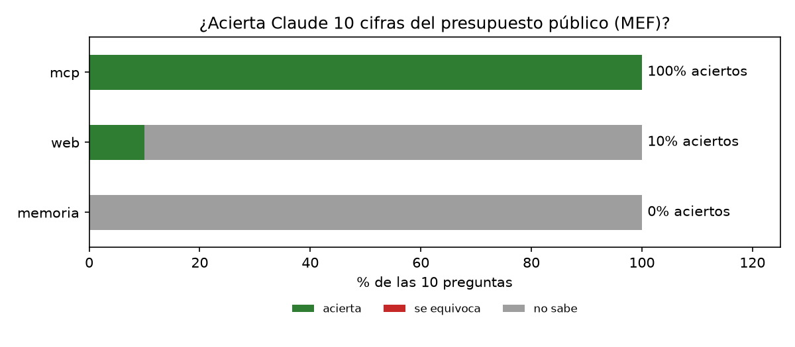

# Informe · Un MCP con la ejecución presupuestal del MEF (Consulta Amigable)

**Autor:** Alvaro Carhuamaca · Sesión 04, Data Science con Python

En vez de las series del BCRP, construí un servidor MCP con FastMCP sobre **Consulta Amigable del MEF**, el portal que
muestra cuánto presupuesto tiene y cuánto gasta cada entidad del Estado peruano. Consulta Amigable no tiene una API
oficial: el servidor arma la misma URL que usa el portal (`Navegar_7.aspx?y=2026&1=E&2=11&3=`), lee la tabla HTML con
pandas y devuelve los datos con la URL como fuente.

| Pieza | Qué hace |
|---|---|
| `buscar_entidades(texto)` | Busca sectores y pliegos por nombre y devuelve su código ("salud" → sector 11, pliego 011) |
| `ejecucion(anio, desagregar_por, ...)` | PIA, PIM, certificado, compromiso, devengado, girado y avance %, con filtros por nivel, sector, pliego, departamento o genérica |
| `resumen(...)` | Totales, avance total y filas extremas, para que el modelo no sume ni divida a mano |
| `comparar_anios(a, b, ...)` | **Herramienta propia:** PIM y avance de dos años fila por fila, con la variación % y las dos fuentes |
| Recurso `mef://pliego/{sector}/{pliego}` | Ficha de un pliego en 2026 (`@mef:mef://pliego/11/011`) |
| Prompt `informe_ejecucion(entidad)` | Pide un informe que cite año, filtros y fuente de cada cifra |

`test_server.py` tiene 10 pruebas con datos reales (`uv run pytest -q` → **10 passed**). Como el PIM y el devengado
cambian a diario, las pruebas usan el **PIA**, que es fijo durante el año.

## Resultados

`uv run evaluar.py --modos memoria web mcp`, con Haiku, sobre las 10 preguntas de `preguntas.csv` (PIA 2026 y cierre
2025, cifras que ya no cambian):

| Modo | Acierta | Se equivoca | No sabe | Segundos promedio |
|---|---|---|---|---|
| memoria (sin herramientas) | 0 | 0 | 10 | 4.9 |
| web (WebSearch + WebFetch) | 1 | 0 | 9 | 20.9 |
| **mcp (mi servidor)** | **10** | **0** | **0** | **16.0** |

La corrida base, solo memoria contra MCP, está en `resultados_base.csv` y dio lo mismo: 0 contra 10 de 10.

## Qué falló cada modo y por qué

- **Memoria: 10 "no sé".** Las cifras de 2025 y 2026 son posteriores a lo que el modelo aprendió, y la instrucción "si no
  puedes saberlo con certeza, pon null" funcionó: Claude no inventó ninguna cifra y dijo que no tenía acceso al MEF.
- **Web: 9 "no sé" y 1 acierto.** Según la columna `fuente`, Claude **no pudo abrir Consulta Amigable**: el portal es una
  aplicación dinámica de ASP.NET, así que la página llegaba vacía, con error 404, o con dominios que no resolvían.
  Encontró cifras en fuentes secundarias (reportes del Congreso, la Mesa de Concertación y ComexPerú), algunas correctas,
  como el PIA del Gobierno Nacional (162,305.2 millones), pero no pudo comprobarlas en la fuente oficial y respondió
  null. Su único acierto (`avance_nac_25` = 96.0 %) sale de un reporte del Congreso del 9 de enero de 2026, con un PIM
  ligeramente distinto (157,389.1 frente a 157,330.8 millones). Entra en la tolerancia de 0.1 por el redondeo, pero
  viene de otro corte de fecha.
- **MCP: 10 de 10.** Cada respuesta cita el año, el filtro y la URL de Consulta Amigable. Tarda más que la memoria
  (16 s frente a 5 s) porque busca el código y llama al MEF, pero menos que la web (21 s).

## Dos cifras comprobadas a mano en Consulta Amigable

| Cifra | Mi MCP | Web del MEF | Link |
|---|---|---|---|
| PIA 2026, Gobierno Nacional | S/ 162,305,205,072 | S/ 162,305,205,072 | [Navegar_7.aspx?y=2026&1=](https://apps5.mineco.gob.pe/transparencia/Navegador/Navegar_7.aspx?y=2026&1=) |
| PIM 2025, Gobiernos Locales | S/ 53,613,348,120 | S/ 53,613,348,120 | [Navegar_7.aspx?y=2025&1=](https://apps5.mineco.gob.pe/transparencia/Navegador/Navegar_7.aspx?y=2025&1=) |

## Dos errores que encontré con datos reales

1. **Los códigos de pliego se repiten entre sectores.** El pliego `011` es el Despacho Presidencial en el sector 01 y el
   Ministerio de Salud en el sector 11. Por eso el recurso pide los dos códigos: `mef://pliego/11/011`.
2. **Filtrar y desagregar por la misma dimensión.** Al probar el MCP, Claude Code notó que
   `ejecucion(..., desagregar_por="pliego", pliego="011")` devolvía los cinco pliegos del sector Salud: en la URL, el
   filtro y la desagregación usan el mismo parámetro (`3`), y el segundo borraba al primero. Lo arreglé con `_tabla()`,
   que pide la tabla sin ese filtro y se queda con la fila pedida, y agregué una prueba para que no vuelva a pasar.

## Conclusión

Vale la pena construir un MCP cuando la fuente oficial **no se deja leer con una búsqueda web**, como Consulta Amigable,
que es dinámica y no tiene API. También cuando las cifras cambian a diario o cuando hace falta citar exactamente de dónde
sale cada número. En este caso la web solo encontró cifras de segunda mano y casi nunca se atrevió a darlas. La búsqueda
web basta para datos estáticos que ya aparecen en noticias o informes publicados. Un MCP cuesta más construirlo, pero
cada respuesta queda repetible, con su fuente, y sin cuentas a mano del modelo.
